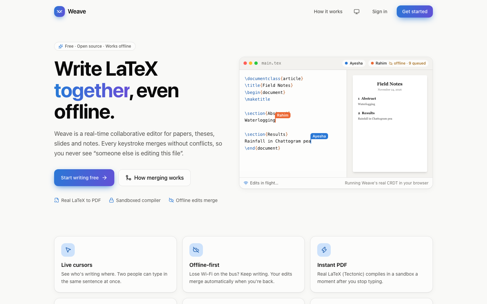
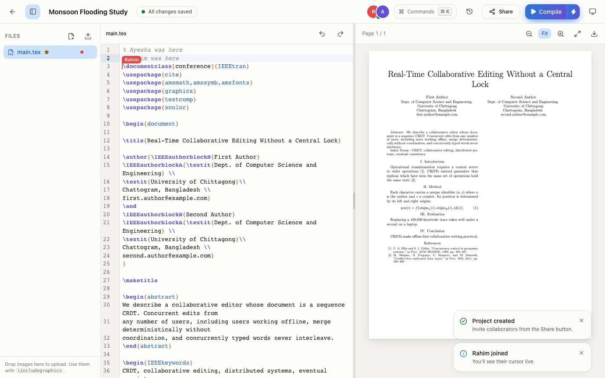
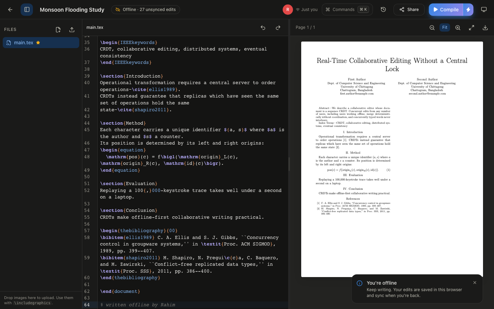
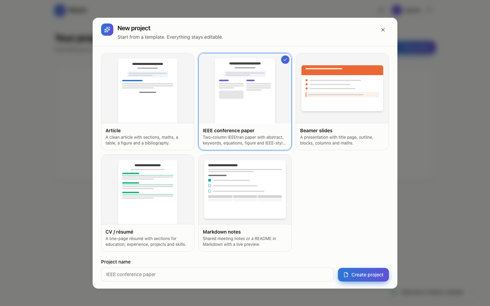
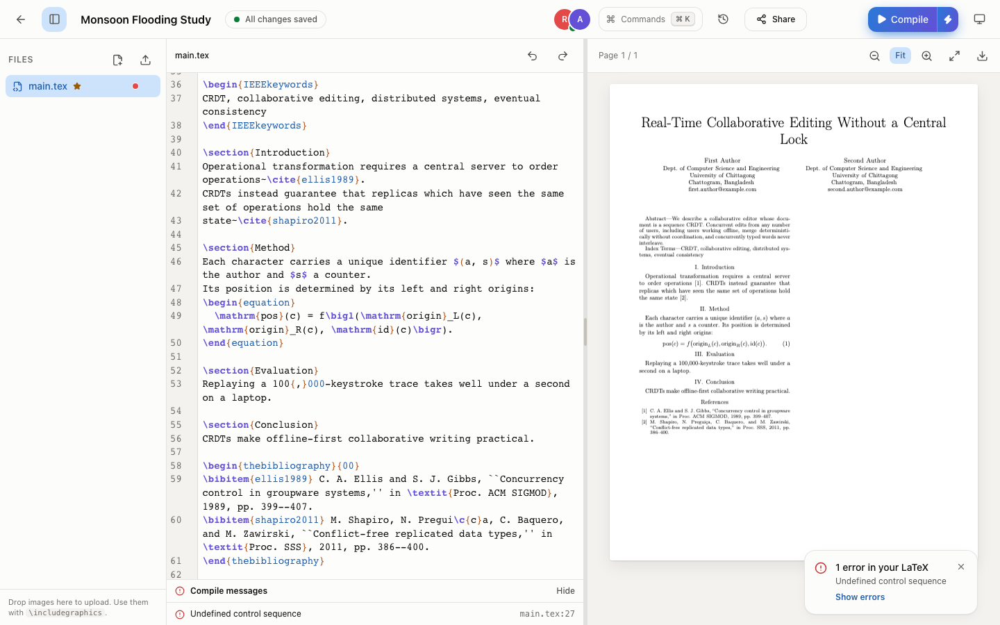

# Weave: collaborative LaTeX, even offline

[](https://github.com/arafatsheikh098/weave/actions/workflows/ci.yml)


Weave is a free, self-hosted, Overleaf-style editor for LaTeX and Markdown. Several people type in
the same document at the same time, and every edit merges without conflicts, even edits made
**offline**. It runs on a **sequence CRDT written from scratch**, uses a **hand-written CodeMirror
binding**, and compiles real LaTeX in a **sandboxed Tectonic** container.



## Features

- **Real-time co-editing:** live cursors and selections with names, a presence list, and
  join/leave notifications.
- **Offline-first:**
  - Keep typing with no connection; edits are stored in IndexedDB.
  - The status bar shows "Offline · N unsynced edits".
  - Everything merges on reconnect.
- **No interleaving:** if two people type at the same spot, their words stay whole. Ordering
  follows FugueMax ([docs/CRDT.md](docs/CRDT.md)).
- **LaTeX to PDF:**
  - Auto-compiles when you stop typing; <kbd>Ctrl/⌘ S</kbd> compiles on demand.
  - pdf.js preview that keeps the last good PDF while you fix an error.
  - Clickable errors mapped to `file:line`.
- **Projects:**
  - Multi-file projects (`.tex`, `.bib`, `.sty`, Markdown) with drag-and-drop image uploads.
  - Starter templates: article, IEEE paper, Beamer slides, CV, Markdown notes.
- **Per-user undo** that never reverts a collaborator's work.
- **Version history:** named versions; restoring one is itself undoable.
- **Sharing:** editor or viewer invite links and role management.
- **Polished UI:**
  - <kbd>Ctrl/⌘ K</kbd> command palette and keyboard shortcuts.
  - Resizable editor/PDF split, first-run tour, toasts, light and dark themes.
  - Mobile read-only view; reduced-motion support.

| Two people, one paragraph | Offline, then merged |
|---|---|
|  |  |

| Template gallery | Compile errors you can click |
|---|---|
|  |  |

## How it works

```
browser: CodeMirror ⇄ CRDT replica ⇄ IndexedDB ──WebSocket──▶ Node server ⇄ Postgres (op log + snapshots)
                                                                   │
                                                                   └──internal network──▶ Tectonic sandbox
```

1. **Characters have identities.** Each character gets an id (author, counter) and remembers the
   characters it was typed between.
2. **Merging is deterministic.** A deterministic rule (YjsMod, proven equivalent to FugueMax)
   decides the order of concurrent inserts. Any two replicas that have seen the same edits hold
   identical text.
3. **Syncing only sends what's missing.** Version vectors say exactly what each side lacks, so
   reconnecting after hours offline sends only the difference.

Details:
- [docs/CRDT.md](docs/CRDT.md): the algorithm, the correctness argument, garbage collection,
  undo and benchmarks.
- [docs/ARCHITECTURE.md](docs/ARCHITECTURE.md): the protocol, persistence, security and the
  compile sandbox's trade-offs.

**Performance:** a 100,000-keystroke trace runs at about 250,000 keystrokes per second locally.
Replaying it on a fresh replica takes 0.15 s, and two 50,000-keystroke concurrent sessions merge
in 0.4 s.

## Quick start

```bash
cp .env.example .env      # set JWT_SECRET to a long random string
docker compose up --build
```

Open **http://localhost:8081** and create an account. The first build pre-warms the LaTeX package
cache, so it takes a few minutes.

## Development

```bash
npm install
docker compose up -d db                          # Postgres on localhost:5434
npm run typecheck                                # also builds the shared packages
npm run dev -w @weave/server                     # API + WebSockets on :8001
docker compose up -d compile                     # or COMPILE_URL to any compile service
npm run dev -w @weave/web                        # http://localhost:5174
```

### Checks

```bash
npm run lint && npm run typecheck && npm test   # 118 tests: CRDT, protocol, server, compile, web
npm run bench                                   # CRDT benchmark
```

Server integration tests need the Postgres from `docker compose up -d db` (or set
`TEST_DATABASE_URL`).

## Project layout

```
packages/crdt       the CRDT: doc.ts (integration, sync, anchors), undo.ts, codec.ts; tests + bench
packages/protocol   WebSocket message types, zod validation, limits
apps/server         Fastify + ws: auth, projects, rooms, persistence (op log + snapshots), history
apps/compile        sandboxed Tectonic service + TeX log parser
apps/web            React app: editor binding, offline sync client, workspace UI, landing page
docs                CRDT.md, ARCHITECTURE.md, screenshots
```

## License

[MIT](LICENSE)
