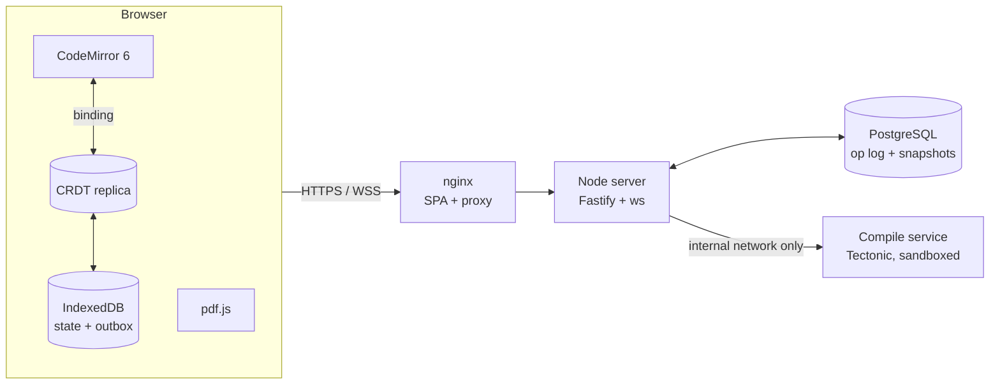

# Architecture



| part | tech | responsibility |
|---|---|---|
| `packages/crdt` | TypeScript, no deps | the sequence CRDT (see [CRDT.md](CRDT.md)) |
| `packages/protocol` | zod | message types, validation, limits shared by client and server |
| `apps/server` | Fastify, ws, pg, argon2, jose | auth, projects, rooms, persistence, history, compile proxy |
| `apps/compile` | Node + Tectonic | sandboxed LaTeX → PDF with parsed diagnostics |
| `apps/web` | React 19, Vite, Tailwind 4, CodeMirror 6, pdf.js | the app |

## Sync protocol

One WebSocket per open project (`/api/projects/:id/ws`, authenticated by the session cookie).

```
client → { t: "join", file, vv }            vv = what this replica has
server → { t: "sync", file, ops, vv }       ops the client lacks (delta)
      or { t: "state", file, state, vv }    full state, if the server's op log can't cover it
client → { t: "ops", file, ops }            the outbox: local ops the server hasn't acknowledged
server → { t: "ack", file, vv }             to the sender
server → { t: "ops", file, ops, from }      to everyone else with the file open
client ↔ { t: "presence", file, cursor }    cursors as CRDT anchors, relayed by the server
```

The same handshake runs on first open, after a reconnect, and after hours offline. The version
vectors tell each side exactly what to send.

## Offline-first client

- **Persistence:** each file's replica (state + outbox) is saved to IndexedDB shortly after every
  change. Edits made while offline survive a closed tab.
- **Connection:** the client reconnects with exponential backoff and jitter, and reacts to the
  browser's `offline`/`online` events immediately.
- **Status:** the status pill shows the connection state and the number of unacknowledged edits:
  "All changes saved", "Saving…", or "Offline · N unsynced edits".
- **Fresh agent per page load:** each load gets a new agent id, and stored outbox ops keep their
  original ids. Two tabs therefore never share an agent.
- **Not built yet:** opening the app *cold* while offline would need a service worker.

## Server

- **Rooms:** a room per project; sessions join files inside it. Each session's messages are
  handled strictly in order. Ops are integrated into the server's replica, appended to `doc_ops`,
  acknowledged and relayed.
- **Snapshots:** every 300 ops (and when the last editor leaves a file) the server writes a
  snapshot to `doc_snapshots` and deletes the ops it covers. On load it reads the snapshot plus
  any later ops. Files are reference-counted and unloaded a minute after the last session leaves.
- **Accounts:** argon2id password hashes, HS256 JWT in an httpOnly SameSite=Lax cookie, and a
  10/min rate limit on auth routes.
- **Projects:** roles owner/editor/viewer. Share links grant editor or viewer (never a downgrade
  for existing members). Viewers' ops are rejected server-side.
- **Limits:** messages ≤ 1 MB and ≤ 5,000 ops, validated with zod. Each session gets a token
  bucket (60 msg/s sustained, burst 200) and is disconnected after repeated abuse. Uploads accept
  PNG/JPEG/GIF/SVG/PDF only, ≤ 5 MB; file paths are validated. HTTP has a global rate limit.
- **History:** named project versions store every text file. Restoring first saves an automatic
  "Before restoring…" version, then applies minimal edits through the CRDT as a server agent, so
  connected editors see the change live and their cursors stay put.

## Compile sandbox and its trade-offs

The compile service runs **Tectonic** (a self-contained TeX engine) behind a tiny HTTP API.

- `--untrusted` mode: no shell-escape (`\write18`), and no reading files outside the project
  (verified: `\immediate\write18{…}` does nothing).
- Paths are validated (no absolute paths or `..`), with limits on file count and request size.
- A 45 s wall-clock timeout kills runaway compiles; at most two run at once; results are cached by
  a SHA-256 of the inputs.
- The container runs as a non-root user with a **read-only root filesystem**, a tmpfs `/tmp`, all
  capabilities dropped, `no-new-privileges`, and 1 GB memory / 2 CPU / 128 PID limits.
- **Network: none by default.** The container sits on an `internal: true` Docker network with no
  route out. Tectonic normally downloads TeX packages on demand, so the image **pre-warms its
  package cache at build time** by compiling every starter template plus a document that loads
  about 40 common packages (amsmath, tikz, pgfplots, biblatex-free natbib, listings, siunitx,
  beamer, IEEEtran…). At runtime Tectonic runs `--only-cached`.
  - Upside: a malicious document can't reach the network at all.
  - Downside: a package that isn't cached fails with a clear error.
  - To allow downloads, run with `docker-compose.network.yml`. This adds an egress network and a
    writable cache volume; everything else stays sandboxed.

Diagnostics come from Tectonic's `error: file:line: message` lines and from the TeX log (`! …` +
`l.<n>`). The log is attributed to the innermost *project* file open at that point, so errors in
`chapters/intro.tex` point there rather than at `main.tex`.

## Testing

| layer | how |
|---|---|
| CRDT | property-based convergence over thousands of random concurrent edits, interleaving tests, undo, benchmark |
| protocol | validation of real CRDT output and malformed input |
| server | integration tests over real WebSockets and Postgres: concurrent merge, offline reconnect, restart persistence, presence, permissions, malformed input, files, versions, compile proxy |
| compile | log parser unit tests; sandbox checked manually (offline compile of the IEEE template, shell-escape blocked) |
| web | CodeMirror ↔ CRDT binding (local, remote, concurrent, undo, anchors), status pill, palette search |
| end to end | two Playwright browsers on the Docker stack: concurrent typing at one spot converges without interleaving; one goes offline, both keep typing, it reconnects and both match the server; the IEEE template compiles; errors map to `main.tex:27`; mobile layout has no horizontal overflow |
